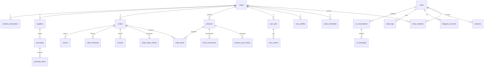

# Base de données — TOUT EN UN BUSINESS MANAGER

- **Version** : 0.1 (Phase 0 — cadrage)
- **Date** : 22/11/2026
- **SGBD** : PostgreSQL (via Drizzle ORM, migrations versionnées)
- **Statut** : À valider avant implémentation

---

## 1. Principes

| Principe | Application |
|---|---|
| Multi-boutique | Toute table métier porte `shop_id` (sauf tables transverses : `users`, `sessions`, `telegram_accounts`, `ai_*`, `jobs`, `audit_logs`). |
| Isolation | Filtre `shop_id` **obligatoire côté serveur** ; un utilisateur ne voit que ses boutiques. |
| Unicité | Une boutique réelle ne peut être ajoutée deux fois : `UNIQUE(platform, external_shop_id)` ; un produit externe une seule fois : `UNIQUE(shop_id, external_product_id)`. |
| Intégrité | Clés étrangères, `ON DELETE` explicites, `NOT NULL`, `CHECK` sur les montants et quantités. |
| Finances | Montants entiers + devise ; taux de change datés ; dates UTC. |
| Audit | Tables d'historique (`audit_logs`, `*_history`, `sync_events`, `order_status_history`). |
| Reprise | Point de reprise persisté par boutique/ressource (`sync_profiles`). |
| Idempotence | Clés externes uniques + `idempotency_key` sur les traitements. |

---

## 2. Tables (par module)

> Convention : `id uuid PK default gen_random_uuid()`, `created_at timestamptz default now()`, `updated_at timestamptz`. Montants : `integer` (FCFA entier) ou `bigint` si volume important ; toujours avec `currency char(3)`.

### 2.1 auth / users

**`users`**
| Colonne | Type | Contraintes |
|---|---|---|
| id | uuid | PK |
| email | citext | UNIQUE NOT NULL |
| password_hash | text | NOT NULL |
| full_name | text | NOT NULL |
| phone | text | |
| locale | text | default `fr` |
| timezone | text | default `Africa/Abidjan` |
| is_active | boolean | default true |
| two_factor_enabled | boolean | default false |
| two_factor_secret_enc | text | AES-256-GCM |
| last_login_at | timestamptz | |
| created_at / updated_at | timestamptz | |

**`sessions`** : `id`, `user_id → users`, `token_hash`, `expires_at`, `ip`, `user_agent`, `revoked_at`, `created_at`. Index `(token_hash)`, `(user_id)`.
**`login_attempts`** : `id`, `email`, `ip`, `success`, `created_at`. Index `(ip, created_at)`.
**`password_reset_tokens`** : `id`, `user_id`, `token_hash`, `expires_at`, `used_at`.
**`telegram_accounts`**
| Colonne | Type | Contraintes |
|---|---|---|
| id | uuid | PK |
| telegram_id | bigint | UNIQUE NOT NULL |
| username / first_name / last_name / photo_url | text | |
| linked_user_id | uuid | FK users, NULL |
| link_code | text | NULL, usage unique |
| link_code_expires_at | timestamptz | |
| linked_at | timestamptz | |
| created_at | timestamptz | |

**`user_notification_prefs`** : `user_id`, `channel` (`telegram`\|`web`), `type`, `enabled boolean`, `quiet_start`, `quiet_end`, PK `(user_id, channel, type)`.

### 2.2 shops

**`shops`**
| Colonne | Type | Contraintes |
|---|---|---|
| id | uuid | PK |
| owner_user_id | uuid | FK users |
| name | text | NOT NULL |
| platform | text | default `jumia` |
| external_shop_id | text | NOT NULL (id Jumia) |
| country | text | ISO 3166-1 alpha-2 |
| currency | char(3) | NOT NULL |
| connected_at | timestamptz | |
| last_sync_at | timestamptz | |
| last_sync_status | text | |
| settings | jsonb | |

`UNIQUE(platform, external_shop_id)` — une boutique réelle ne peut pas être ajoutée deux fois.

> **La colonne `shops.status` a été supprimée** (migration `0012`, 25/11/2026).
> Un statut posé au rattachement ne prouvait rien : il cohabitait avec l'état
> réel sans le refléter. L'état de connexion est désormais **calculé** à
> partir des faits (rattachement, compte vendeur lié, données reçues, statut
> de la dernière synchronisation) — voir `src/lib/connection-state.ts` et
> `docs/audit-multiboutique.md`.

**`shop_members`** : `shop_id`, `user_id`, `role` (`owner`\|`manager`\|`stock`\|`accountant`\|`assistant`), `permissions jsonb`, PK `(shop_id, user_id)`.
**`jumia_credentials`** : `id`, `shop_id UNIQUE`, `access_token_enc`, `refresh_token_enc`, `token_type`, `expires_at`, `scope`, `api_user_id`, `created_at`, `updated_at`. Chiffrement AES-256-GCM.
**`sync_profiles`** : `shop_id`, `resource` (`products`\|`orders`\|`stock`\|`finance`\|`invoices`), `cursor`, `last_success_at`, `status`, `error`, PK `(shop_id, resource)`. **Point de reprise persistant.**
**`sync_jobs`** : `id`, `shop_id`, `resource`, `status` (`queued`\|`running`\|`done`\|`partial`\|`error`), `trigger` (`cron`\|`manual`\|`webhook`), `items_total`, `items_done`, `error_code`, `error_message`, `idempotency_key`, `started_at`, `finished_at`, `created_at`. Index `(status, created_at)`, `(shop_id, resource)`.
**`sync_events`** : `id`, `job_id → sync_jobs`, `level`, `message`, `meta jsonb`, `created_at`.

### 2.3 products / inventory

**`products`**
| Colonne | Type | Contraintes |
|---|---|---|
| id | uuid | PK |
| shop_id | uuid | FK shops |
| sku | text | NOT NULL |
| external_product_id | text | |
| name | text | NOT NULL |
| description | text | |
| brand | text | |
| category | text | |
| images | jsonb | |
| price_minor | integer | CHECK ≥ 0 |
| sale_price_minor | integer | CHECK ≥ 0 |
| currency | char(3) | |
| cost_minor | integer | CHECK ≥ 0 |
| stock_qty | integer | default 0 |
| reserved_qty | integer | default 0 |
| status | text | `active`\|`inactive`\|`draft` |
| attributes | jsonb | |

`UNIQUE(shop_id, sku)`, `UNIQUE(shop_id, external_product_id)`. Index `(shop_id, status)`, `(shop_id, category)`, recherche `(shop_id, name)` (pg_trgm).
**`product_price_history`** : `id`, `product_id`, `shop_id`, `field`, `old_minor`, `new_minor`, `currency`, `source`, `changed_by`, `created_at`.
**`stock_movements`** : `id`, `product_id`, `shop_id`, `type` (`in`\|`out`\|`adjust`), `qty`, `reason`, `reference`, `source` (`jumia`\|`local`\|`inventory`), `user_id`, `created_at`. Index `(product_id, created_at)`.
**`inventory_counts`** (P3) : `id`, `shop_id`, `product_id`, `counted_qty`, `expected_qty`, `difference`, `status`, `counted_by`, `created_at`.

### 2.4 orders

**`orders`**
| Colonne | Type | Contraintes |
|---|---|---|
| id | uuid | PK |
| shop_id | uuid | FK shops |
| external_order_id | text | NOT NULL |
| external_order_number | text | |
| status | text | (`pending`\|`ready_to_ship`\|`shipped`\|`delivered`\|`cancelled`\|`returned`\|`failed`) |
| payment_method | text | |
| currency | char(3) | |
| subtotal_minor | integer | |
| shipping_minor | integer | |
| total_minor | integer | |
| customer | jsonb | |
| shipping_address | jsonb | |
| delivered_at / cancelled_at | timestamptz | |
| raw | jsonb | payload source (non modifié) |

`UNIQUE(shop_id, external_order_id)`. Index `(shop_id, status)`, `(shop_id, created_at)`.
**`order_items`** : `id`, `order_id`, `shop_id`, `product_id` NULL, `external_item_id`, `sku`, `name`, `qty`, `unit_price_minor`, `currency`, `status`, `raw jsonb`. Index `(order_id)`.
**`order_status_history`** : `id`, `order_id`, `from_status`, `to_status`, `source`, `created_at`.

### 2.5 invoices

**`invoices`**
| Colonne | Type | Contraintes |
|---|---|---|
| id | uuid | PK |
| shop_id | uuid | FK shops |
| order_id | uuid | FK orders NULL |
| number | text | |
| type | text | `official`\|`internal` |
| official | boolean | |
| currency | char(3) | |
| total_minor | integer | |
| issued_at | timestamptz | |
| storage_key | text | clé R2 (NULL si indisponible) |
| fingerprint | text | SHA-256 du document |
| source | text | |
| created_at | timestamptz | |

Règle : les documents **officiels** ne sont jamais modifiés ; les documents internes portent la mention « Document interne — non officiel ». Si l'API ne fournit pas le document → `storage_key = NULL`, affichage « Indisponible ».

### 2.6 finance / purchasing / returns

**`order_financials`** : `id`, `order_id`, `shop_id`, `commission_minor`, `shipping_fee_minor`, `other_fees_minor`, `net_payout_minor`, `currency`, `source`, `raw jsonb`. Un par commande.
**`suppliers`** : `id`, `shop_id`, `name`, `contact_name`, `email`, `phone`, `country`, `notes`, `created_at`.
**`purchases`** : `id`, `shop_id`, `supplier_id`, `number`, `status`, `currency`, `total_minor`, `ordered_at`, `received_at`, `created_at`.
**`purchase_items`** : `id`, `purchase_id`, `shop_id`, `product_id`, `sku`, `qty`, `unit_cost_minor`, `currency`.
**`expenses`** : `id`, `shop_id`, `category`, `amount_minor`, `currency`, `expense_date`, `description`, `supplier_id` NULL, `created_by`, `created_at`.
**`finance_transactions`** : `id`, `shop_id`, `external_transaction_id`, `type`, `amount_minor`, `currency`, `status`, `matched boolean`, `raw jsonb`, `transaction_date`, `created_at`. `UNIQUE(shop_id, external_transaction_id)`.
**`exchange_rates`** : `id`, `base`, `quote`, `rate numeric(20,10)`, `rate_date`, `source`, `created_at`. `UNIQUE(base, quote, rate_date)`.
**`returns`** : `id`, `shop_id`, `order_id`, `order_item_id`, `product_id`, `reason`, `status`, `qty`, `refund_minor`, `currency`, `restocked boolean`, `created_at`, `resolved_at`.

### 2.7 notifications / audit / ai / jobs / webhooks

**`notifications`** : `id`, `user_id`, `shop_id` NULL, `type`, `title`, `body`, `status` (`pending`\|`sent`\|`failed`\|`grouped`), `sent_at`, `error`, `dedupe_key` NULL, `channel` (`web`\|`telegram`), `created_at`.
Index `(user_id, status)`. Index unique partiel `(user_id, dedupe_key)` **où `dedupe_key` n'est pas NULL** : la clé décrit le *problème* (`coherence:<boutique>:<jour>:<code>:<canal>`) et l'unicité est **par destinataire** — deux gestionnaires d'une même boutique sont tous les deux prévenus.
**`audit_logs`** : `id`, `user_id`, `shop_id`, `action`, `entity_type`, `entity_id`, `old_value jsonb`, `new_value jsonb`, `result`, `ip`, `user_agent`, `created_at`. Index `(shop_id, created_at)`, `(user_id, created_at)`.
**`ai_conversations`** : `id`, `user_id`, `shop_id` NULL, `title`, `created_at`, `updated_at`.
**`ai_messages`** : `id`, `conversation_id`, `role` (`user`\|`assistant`\|`tool`), `content`, `tool_calls jsonb`, `tokens_in`, `tokens_out`, `cost_minor`, `created_at`.
**`ai_usage`** : `id`, `usage_date`, `provider`, `model`, `requests`, `tokens_in`, `tokens_out`, `cost_minor`. Suivi des quotas.
**`product_drafts`** : `id`, `shop_id`, `user_id`, `status` (`draft`\|`ready`\|`published`), `payload jsonb`, `source_image_key`, `created_at`, `updated_at`.
**`jobs`** : `id`, `type`, `shop_id` NULL, `payload jsonb`, `status` (`queued`\|`running`\|`done`\|`failed`), `run_at`, `locked_at`, `locked_by`, `attempts`, `max_attempts`, `last_error`, `idempotency_key`, `result jsonb`, `created_at`, `updated_at`. Index `(status, run_at)`.
**`webhook_events`** : `id`, `provider`, `event_id UNIQUE`, `payload jsonb`, `processed_at`, `error`, `created_at`.
**`app_settings`** : `key PK`, `value jsonb`, `updated_at`.

### 2.8 Entrepôts (P7, volontairement minimal ici)

**`warehouses`** : `id`, `shop_id`, `name`, `address`, `created_at`.
**`product_warehouse_stock`** : `product_id`, `warehouse_id`, `qty`, PK `(product_id, warehouse_id)`.

---

## 3. Relations (diagramme)



Un schéma visuel consultable est fourni en `mockups/database.html`.

---

## 4. Isolation multi-boutiques

### 4.1 Côté application (obligatoire)

- Chaque requête métier est construite avec un `shop_id` issu de la session (sélecteur de boutique) + liste des boutiques autorisées.
- Aucune liste n'est renvoyée sans filtre boutique quand le contexte l'exige (ou contexte « Toutes les boutiques » = uniquement les boutiques autorisées).
- Test d'isolation : un utilisateur A ne peut pas lire/écrire une boutique B (test automatisé).

### 4.2 Côté base (défense en profondeur, optionnelle)

```sql
ALTER TABLE orders ENABLE ROW LEVEL SECURITY;

CREATE POLICY shop_isolation ON orders
  USING (
    shop_id IN (
      SELECT shop_id FROM shop_members
      WHERE user_id = current_setting('app.current_user_id', true)::uuid
    )
  );
```

Le `app.current_user_id` est positionné par l'application au début de chaque transaction. **L'application reste la source de vérité des permissions** (une politique RLS ne remplace jamais un contrôle serveur).

---

## 5. Migrations

- **Drizzle Kit** : `drizzle.config.ts`, dossier `drizzle/` versionné.
- Une migration = un fichier horodaté ; jamais de modification rétroactive.
- Environnements : `dev` (données de démonstration autorisées), `staging` (données de démonstration), `production` (**aucune donnée fictive**).
- Chaque migration a un test de non-régression (schéma + contraintes).

### 5.1 Migrations de l'audit multiboutique

| Migration | Contenu |
|---|---|
| `0012_drop_shop_status.sql` | Suppression de `shops.status` : l'état de connexion est **calculé** (`src/lib/connection-state.ts`), jamais stocké. |
| `0013_coherence_snapshots.sql` | Table `coherence_snapshots` : un instantané par boutique et par jour (volumétries, montants comparés, anomalies). Unique `(shop_id, day)`. |
| `0014_notification_dedupe_key.sql` | Colonne `notifications.dedupe_key` + index unique partiel, pour qu'une alerte ne soit pas renvoyée chaque jour. |
| `0015_awesome_plazm.sql` | Index unique **par destinataire** `(user_id, dedupe_key)` (l'ancien index global faisait se bloquer mutuellement deux gestionnaires d'une même boutique) + colonne `notifications.channel` (`web` / `telegram`) pour tracer chaque envoi. |

---

## 6. Règles d'intégrité (rappel)

- `CHECK (price_minor >= 0)`, `CHECK (qty >= 0)`, `CHECK (commission_minor >= 0)`.
- `ON DELETE RESTRICT` pour les références métier (orders ↔ order_items) ; `ON DELETE CASCADE` pour les logs/historiques.
- `NOT NULL` sur toute clé externe métier.
- Pas de `FLOAT` pour les montants (entiers uniquement).
- Index sur toutes les colonnes de filtre/tri:liste et sur les clés externes.

---

## 7. Volumétrie estimée (ordres de grandeur)

| Hypothèse | Valeur |
|---|---|
| Boutiques | « plusieurs dizaines » (50 visées) |
| Produits / boutique | 1 000 – 5 000 |
| Commandes / boutique / mois | 100 – 2 000 |
| Lignes de commande | ×2 |

Avec 50 boutiques × 2 000 commandes/mois × 2 lignes ≈ **200 000 lignes/mois** sur la période observée. Une base **500 Mo – 1 Go** suffit pour plusieurs mois ; au-delà, une stratégie d'archivage (tables `*_archive` ou partitionnement) sera prévue. Ce point est un **risque quota** suivi en `hebergement-gratuit.md`.
